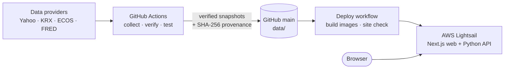

# Market & Portfolio Risk Intelligence (M/PRI)

한국·미국 시장의 스트레스 신호를 모니터링하고, 가상 포트폴리오의 **수익 기여도 · 벤치마크 대비 성과요인 · 비중 변경에 따른 위험 변화**를 분석하는 웹 대시보드입니다. AI 퀀트 과정 프로젝트로 만들었고, AWS에서 운영 중입니다.

*A live web dashboard for Korea and US market stress monitoring, portfolio performance attribution and risk analysis, with Korean and English interfaces.*

**[사이트 열기 · Live site](https://mpri.hbgma4wzzydww.ap-northeast-2.cs.amazonlightsail.com/) · [포트폴리오 분석 · Portfolio](https://mpri.hbgma4wzzydww.ap-northeast-2.cs.amazonlightsail.com/portfolio) · [조기경보 백테스트 · Backtest](https://mpri.hbgma4wzzydww.ap-northeast-2.cs.amazonlightsail.com/validation) · [발표자료 · Slides](https://jm973279.github.io/market-portfolio-risk-signals-intelligence/presentation/)**

## 담당 작업 · My contribution

- **포트폴리오 성과분석 웹/API**를 설계·구현했습니다. 종목별 수익 기여도와 Brinson–Fachler 성과요인을 계산하고, 각각의 합이 포트폴리오 수익률과 벤치마크 대비 초과수익에 정확히 맞는지 테스트로 검증했습니다. ([구현 기록 PR #2](https://github.com/JM973279/market-portfolio-risk-signals-intelligence/pull/2))
- 같은 기간·벤치마크에서 **비중 변경 전후의 연율 변동성과 위험 기여도**를 비교하는 기능을 만들었습니다.
- 원화(국내 주식·ETF)와 달러(미국 ETF) 포트폴리오를 지원하고, 화면과 API 응답을 한국어·영어로 제공합니다.
- 이 저장소의 **데이터 수집·검증 자동화(GitHub Actions)와 AWS Lightsail 배포**를 운영합니다.

*I designed and built the portfolio analytics web app and API: per-holding return contribution and Brinson–Fachler attribution, each tested to reconcile exactly with the portfolio return and the excess return over the benchmark, plus a like-for-like comparison of volatility and risk contributions before and after a weight change. KRW and USD portfolios, Korean and English. I also run the repository's automated data collection and verification (GitHub Actions) and its AWS Lightsail deployment.*

## 화면 · Pages

| 화면 · Page | 내용 · What you can see |
| --- | --- |
| [포트폴리오 분석 · Portfolio](https://mpri.hbgma4wzzydww.ap-northeast-2.cs.amazonlightsail.com/portfolio) | 과거 가상성과, 종목별 수익 기여도, KODEX 200(원화)·SPY(달러) 대비 성과요인, 비중 변경 전후 위험 비교 · Past performance, contributions, attribution against the benchmark, and risk before/after a weight change |
| [한국 시장 · Korea](https://mpri.hbgma4wzzydww.ap-northeast-2.cs.amazonlightsail.com/korea) · [미국 시장 · US](https://mpri.hbgma4wzzydww.ap-northeast-2.cs.amazonlightsail.com/us) | 시장 스트레스 지수(MSI)와 V1 위험 점수의 흐름, 한국은 시장 확산도와 개장 전 미국 가격 참고 · Market Stress Index and V1 risk score; Korea adds breadth and a US pre-open reference |
| [조기경보 백테스트 · Backtest](https://mpri.hbgma4wzzydww.ap-northeast-2.cs.amazonlightsail.com/validation) | 표본 외 예측으로 10거래일 내 스트레스 경보 평가, 기준 조정과 연도별 정밀도·재현율 · Out-of-sample 10-day stress alerts with adjustable thresholds |
| [급락 시나리오 · Sell-offs](https://mpri.hbgma4wzzydww.ap-northeast-2.cs.amazonlightsail.com/cases) | KOSPI 200·SPY 과거 급락의 낙폭, 직전 위험 점수, 사전 경보 여부 · Past sell-offs by drawdown, prior risk score and whether an alert came first |
| [데이터와 방법론 · Methodology](https://mpri.hbgma4wzzydww.ap-northeast-2.cs.amazonlightsail.com/sources) | 원천, 관측일, 계산 방법 · Sources, observation dates and methods |

## 시스템 구성 · Architecture



- **서비스는 외부 제공처를 직접 호출하지 않습니다.** GitHub Actions가 수집·검증해 저장소에 올린 스냅샷만 읽습니다. 가격 관측일과 위험 추정일을 따로 기록하고, 검증에 실패하면 마지막 검증본을 유지합니다.
- **한국과 미국은 독립적으로 갱신됩니다.** 한 시장의 원천이 늦거나 실패해도 다른 시장은 게시됩니다.
- **배포 전후로 검사합니다.** 이미지를 runner에서 띄워 모든 화면과 데이터 일치를 확인한 뒤 배포하고, 배포 후 실서비스 검사가 실패하면 이전 배포로 되돌립니다. AWS 권한은 GitHub OIDC 단기 자격증명을 씁니다.

*The service never calls data providers directly: it serves only snapshots that GitHub Actions collected, verified and committed. Korea and US refresh independently. Each deploy is checked before and after going live and rolled back on failure.* 자세한 일정과 실패 처리: [운영 문서 · Operations](docs/operations.md)

## 기술 스택 · Tech stack

- **Web:** Next.js 16, React 19, TypeScript
- **Analytics API:** Python 3 (표준 라이브러리 중심 · standard library first), 단위 테스트 229개 · 229 unit tests
- **Data & automation:** GitHub Actions (수집·검증·배포 workflow 9개 · 9 workflows), SHA-256 provenance
- **Infrastructure:** Docker, AWS Lightsail Container Service (Seoul), GitHub OIDC
- **Data:** Yahoo Finance (가격 · prices), KRX Open API (KOSPI 200·VKOSPI 지수 · indices), 한국은행 ECOS·FRED (금리 · rates)

## 검증과 해석 · Validation

- **성과와 위험** — 과거 수정종가로 만든 가상 포트폴리오입니다. 성과요인의 합은 벤치마크 대비 초과수익과 정확히 맞습니다. [포트폴리오 계산 방법](docs/portfolio.md)
- **경보와 급락 사례** — 표본 외 백테스트와 동결 V1 모델의 운영 추론을 구분합니다. [급락 진단 결과](reports/event_diagnostics.md) · [신호 실험](reports/signal_checks.md)
- **개장 전 미국 가격** — 한국 화면의 EWY·SOX 수익률은 표시 전용 참고값이며 점수와 모델을 바꾸지 않습니다. 과거 빈도이지 예측 확률이 아닙니다.

*Hypothetical portfolios from adjusted closes; attribution reconciles exactly. Out-of-sample backtests are kept apart from the frozen V1 model's operational inference. The US pre-open figures are a display-only reference, not forecasts.*

## 저장소 구조 · Repository layout

| 경로 · Path | 내용 · Contents |
| --- | --- |
| `frontend/` | Next.js 사이트 · web app |
| `qsignals/` | 포트폴리오 분석 API, 데이터 수집·검증, 점수·진단 · portfolio API, collectors, scores and diagnostics |
| `market_engine/` | 급락 시나리오 생성 · sell-off scenario builder |
| `data/` | 검증된 스냅샷과 provenance · verified snapshots and provenance |
| `reports/` | 진단·신호 실험 결과 · diagnostics and experiments |
| `tests/` | 단위 테스트 · unit tests |
| `infra/aws/`, `.github/workflows/` | 배포와 자동화 · deployment and automation |

## 로컬 실행 · Run locally

```bash
docker compose -f infra/aws/compose.yaml up --build   # http://localhost:3300
python3 -m unittest discover -s tests -t .            # tests
```

## 관련 저장소 · Related

- [연구 코드 · Research code](https://github.com/JM973279/market-portfolio-risk-intelligence) — 초기 시장 스트레스 모델 검증과 포트폴리오 위험 연구
- [Docker 실행 도구 · Docker runner](https://github.com/JM973279/market-portfolio-risk-dashboard-docker) — 연구용 원본의 로컬 실행
